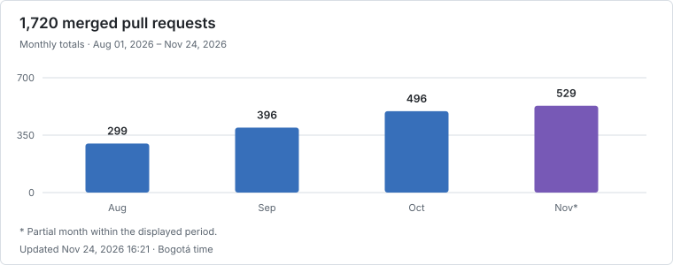

# Hi, I’m David.

I’ve spent the last ten years building software to make people’s work easier.

These days I’m the co-founder and CTO of [Alero](https://joinalero.ai/). I work on AI coworkers for home care and transportation, and on better ways to build software with coding agents.

I write about the decisions behind that work, including the ones I got wrong. I’m still figuring things out, and I like comparing notes.

[avilag.dev](https://avilag.dev/) · [LinkedIn](https://www.linkedin.com/in/davidavilag/)

## From my workbench

### [AI that handles real work](https://joinalero.ai/)

At Alero, that means automating the full patient lifecycle and building agents for transportation processes.

### [My software factory](https://avilag.dev/blog/building-the-right-thing/)

My workflow for coding agents: define the change, review the design, then look for evidence that it works.

### [Why I deleted half of my backend tests](https://avilag.dev/blog/which-tests-are-worth-keeping/)

A story about finding out which tests were earning their place.

## Merged pull requests

<!-- PR-CHART:START -->
<a href="https://lespoir.github.io/Lespoir/" title="Explore daily merged pull requests">
  <picture>
    <source media="(prefers-color-scheme: dark)" srcset="assets/merged-prs-dark.svg">
    <source media="(prefers-color-scheme: light)" srcset="assets/merged-prs-light.svg">
    
  </picture>
</a>
<!-- PR-CHART:END -->
